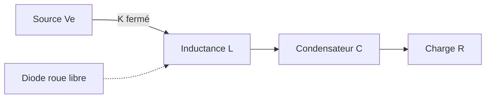

Les hacheurs (convertisseurs DC-DC) permettent de modifier une tension continue par découpage à haute fréquence.

## Hacheur série (buck)

Rapport cyclique **α** et relation tension de sortie / tension d'entrée en conduction continue :

$$
\frac{V_s}{V_e} = \alpha, \qquad \alpha = \frac{t_{on}}{T}
$$

Ondulation du courant dans l'inductance :

$$
\Delta I_L = \frac{V_e - V_s}{L} \cdot \alpha \cdot T
$$

## Topologie



## Bloc de code — calcul du rapport cyclique (Python)

```python
def rapport_cyclique(Ve: float, Vs: float) -> float:
    """Rapport cyclique d'un hacheur série en conduction continue."""
    return Vs / Ve

print(rapport_cyclique(48, 12))  # -> 0.25
```

## Ressources associées

- [TP — Montages à AOP](/annee-3/semestre-5/tp-aop-montages/)
- Datasheet MOSFET utilisé en TP — à ajouter dans [Ressources](/ressources/)
