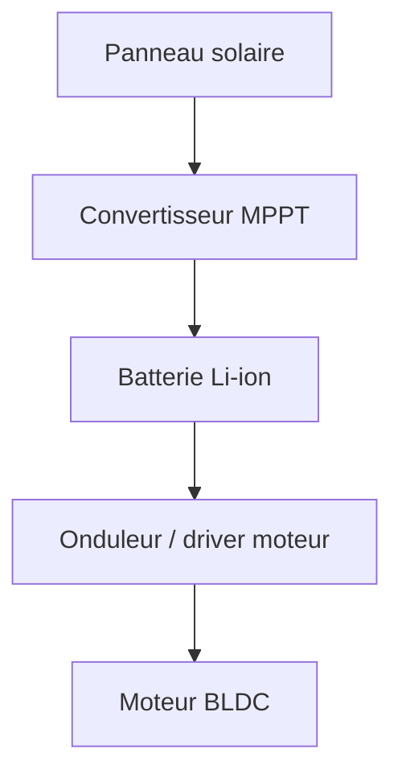

Projet de conception d'un véhicule à propulsion solaire : chaîne de puissance, MPPT, gestion batterie.

## Architecture système

## Points à documenter (checklist de migration Notion)

- [ ] Cahier des charges complet
- [ ] Choix des composants (datasheets)
- [ ] Schémas KiCad (export SVG/PNG dans `src/assets/`)
- [ ] Code embarqué (firmware)
- [ ] Résultats de tests
