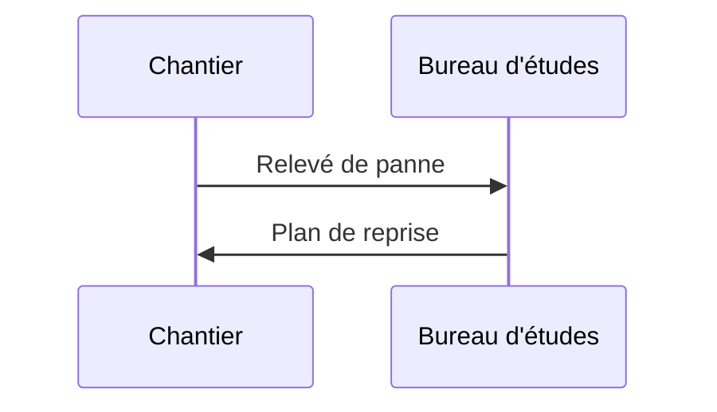

Copiez ce fichier pour créer une nouvelle note. Placez-le dans le bon dossier (`annee-X/semestre-Y/`) selon la hiérarchie.

## Frontmatter disponible

```yaml
---
title: "Titre affiché dans la sidebar et l'onglet"
ue: "UE X.Y — Nom de l'UE"          # optionnel
matiere: "Nom de la matière"          # optionnel
type: cours | tp | projet | sae | rapport | ressource
statut: brouillon | a-relire | complet
---
```

## Formules

Inline : $E = \frac{1}{2} C V^2$

Bloc :

$$
P = U \cdot I \cdot \cos\varphi
$$

## Diagramme Mermaid



## Code

```cpp
// Exemple firmware
void setup() {
  pinMode(LED_BUILTIN, OUTPUT);
}
```

## Pièce jointe PDF

```md
<a href="/fiches/mon-fichier.pdf" download>Télécharger (PDF)</a>
```

Déposez le fichier réel dans `public/fiches/`.
